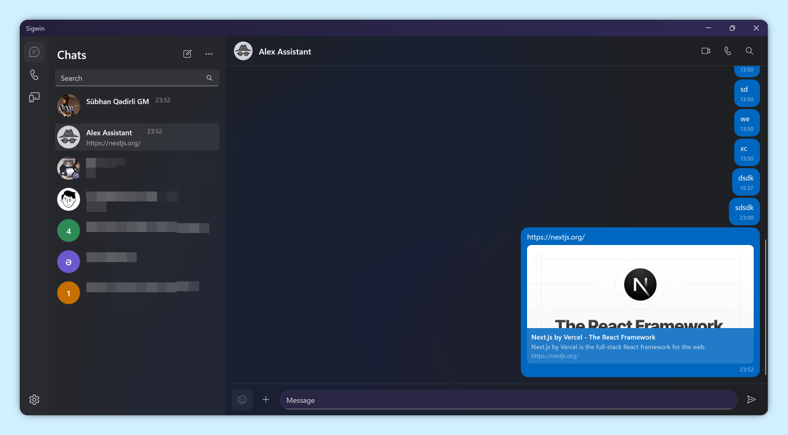
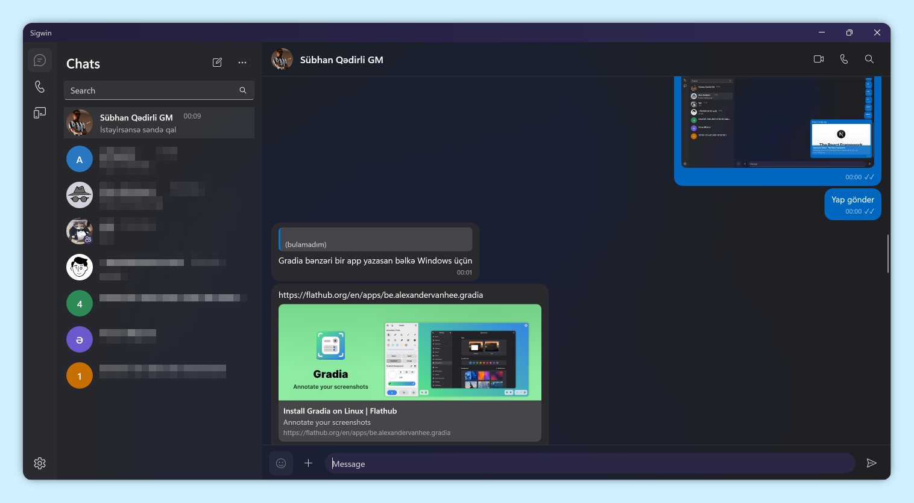

# Sigwin - Unofficial Native WinUI3 Client for Signal

A native Windows messenger client for the Signal network, built as a **linked (secondary)
device** — the same role Signal Desktop plays. It exists to be small and fast where the official
Electron desktop app isn't: a native Rust core and a native WinUI 3 UI, no bundled browser.

> **Archived.** This project is no longer maintained. It's public for reference only —
> feel free to fork it.

> **Unofficial / personal project.** Not affiliated with, endorsed by, or connected to Signal
> Messenger. Does not use the Signal name, logo, or trade dress. See [Legal](#legal).




## What it does

Sigwin links to your phone by scanning a QR code, exactly like Signal Desktop, and then acts as a
full secondary client:

- 1:1 and group conversations, with contact/group names and profile photos resolved automatically
- Sending and receiving text messages, replies (with quoted context), and emoji reactions
- Message edits and "delete for everyone", reflected live
- Image and video attachments — send via file picker, drag-and-drop, or clipboard paste; receive
  with automatic inline preview
- Link previews on messages that contain a URL
- Typing indicators and read receipts
- Persistent local history, encrypted at rest

## Known issues & limitations

This project is archived with real, unresolved bugs — some of them would need reverse-engineering
parts of Signal's server-side/protocol behavior beyond what the `presage`/`libsignal` libraries
expose, which is more than a hobby project can reasonably chase down. Notable ones:

- **Groups don't appear until they get new activity.** `presage` only learns about a group
  reactively, from a message that references it — there's no proactive "list my groups" call.
  A freshly-linked device shows no groups until each one receives a new message.
- **No history from before linking.** Only messages sent/received after the device was linked are
  available. Real Signal Desktop's backfill uses Signal's separate, mostly-unimplemented-here
  "message backups" protocol.
- **Typing indicators only work in 1:1 conversations.** Group typing needs a group-specific ID
  that isn't wired up.
- **Occasional flakiness in profile/group name and photo resolution** — sometimes requires a
  restart or new message traffic to resolve correctly.

### Features that don't exist

- Voice messages
- Stickers
- Message search
- Contact blocking
- Viewing/managing other linked devices from within the app
- Disappearing messages (timer isn't read, displayed, or enforced)
- @mentions
- Creating groups or managing group membership
- Attachments larger than 8 MB (shown as metadata only, not downloaded)

## Architecture

```
+---------------------------+        C ABI (P/Invoke)        +--------------------------+
|  app/  WinUI 3 (C#/XAML)  | <----------------------------> |  core/  Rust cdylib      |
|  MVVM, CommunityToolkit   |   callbacks marshaled to the   |  presage + libsignal     |
|                           |   UI thread via DispatcherQueue|  tokio runtime, sqlcipher |
+---------------------------+                                +--------------------------+
```

**core/** — a Rust `cdylib` built on [`presage`](https://github.com/whisperfish/presage), which
wraps the official Rust `libsignal`. It owns a `tokio` runtime on a background thread, an
encrypted `presage-store-sqlite` (sqlcipher) local store, and every piece of Signal-protocol logic:
linking, sync, sending/receiving, attachment upload/download, reactions, edits, deletes, typing,
and receipts. It exposes a plain C ABI; [`csbindgen`](https://github.com/Cysharp/csbindgen)
auto-generates the C# P/Invoke bindings in `bindings/` at build time. State changes reach the app
through registered callback function pointers — the core never blocks the UI thread.

**app/** — a WinUI 3 (Windows App SDK) desktop app in C#/XAML, MVVM via
`CommunityToolkit.Mvvm`. It owns the chat list, message bubbles (including inline media, quotes,
link previews, and reactions), the composer, and everything else the user sees. Every callback
from the Rust core is marshaled onto the UI thread via `DispatcherQueue` before touching a view
model.

## Getting started

1. Read [docs/setup.md](docs/setup.md) for the toolchain (MSVC, protoc, CMake, NASM, libclang).
2. Build the core: `cd core && cargo build`.
3. Build the app: open `signal-windows-client.slnx` in Visual Studio and run.

See [docs/architecture.md](docs/architecture.md) for more detail on the build constraints and
component design.

## Legal

This is a personal, unofficial client. It deliberately avoids the Signal name, logo, and trade
dress in all UI, package identity, and branding, using the neutral codename **Sigwin**. Signal
does not prohibit third-party clients that use its libraries, but this project keeps branding
clearly distinct.

## License

AGPL-3.0. See [LICENSE](LICENSE).
